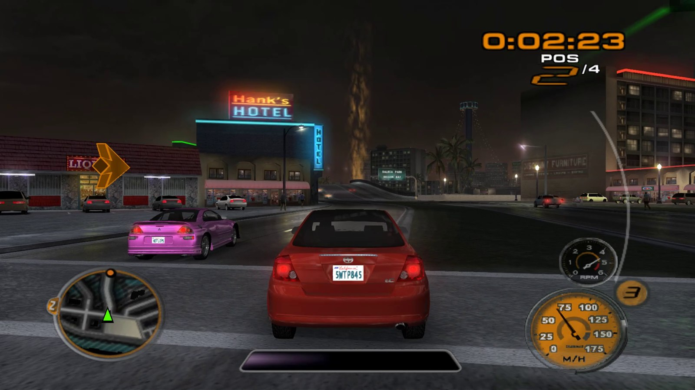
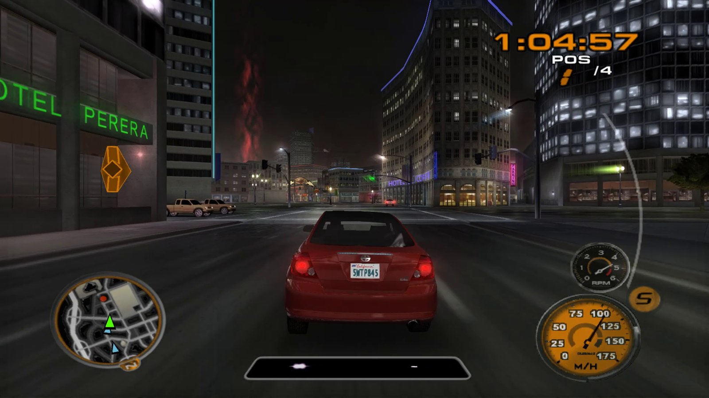
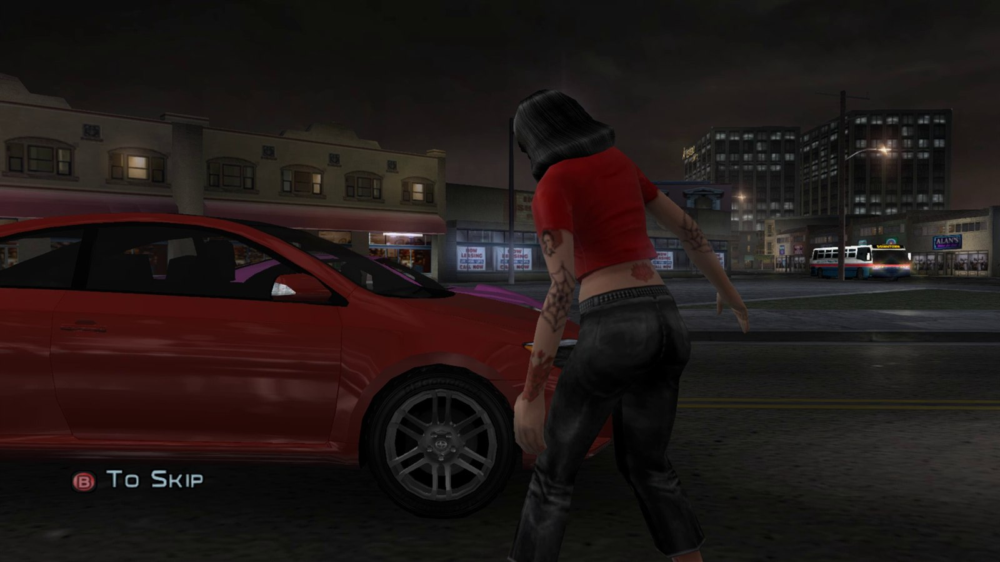
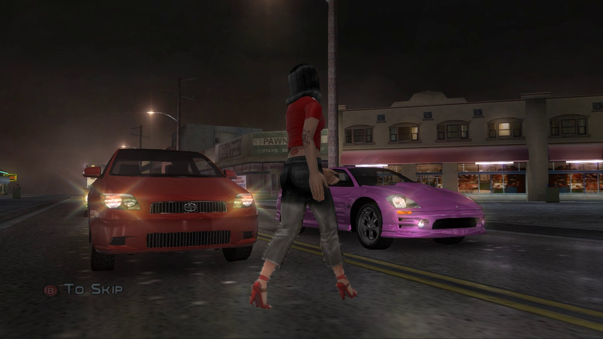
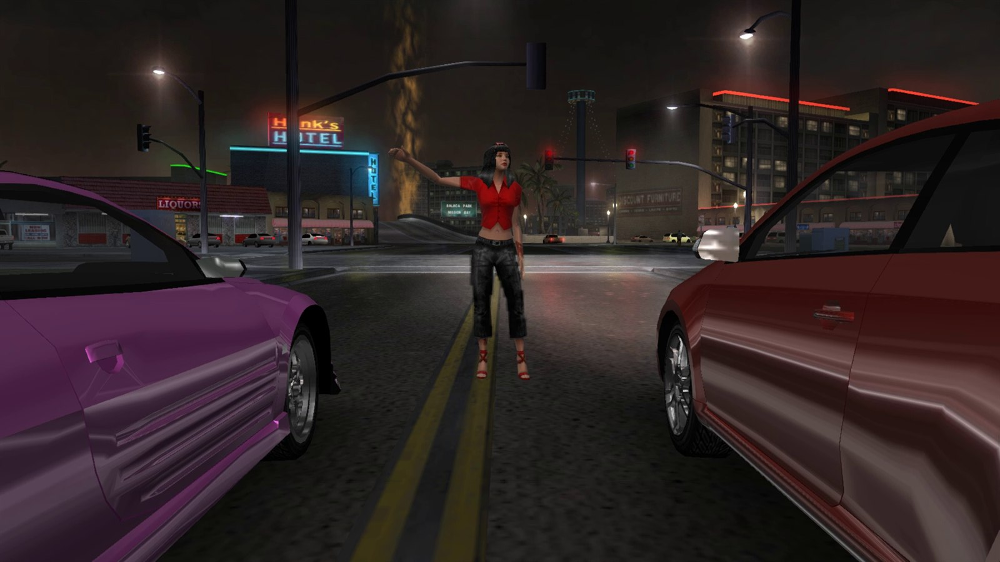
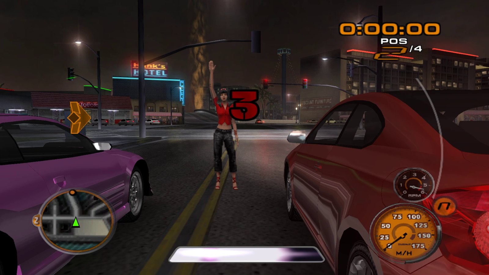

<p align="center"></p>
<p align="center"></p>

# Midnight Club 3: ReDUB

A community port of **Midnight Club 3: DUB Edition Remix** for Windows, Linux, Android, and iOS, built through static recompilation of the original Xbox release.

Import your own supported game files and play. **Normal installation requires no compilation.** ReDUB includes graphics settings, controller support, optional external-music integration, and mobile touch and tilt controls.

**Original Xbox Remix game files required. No original game data is included.** This project is unofficial and is not affiliated with Rockstar Games, Take-Two, or Microsoft.

<p align="center"><a href="https://github.com/dea7hsmiless/Midnight-Club-3-ReDUB/releases/latest"><strong>Download latest release</strong></a> · <a href="#quick-start">Quick start</a> · <a href="#screenshots">Screenshots</a> · <a href="https://github.com/dea7hsmiless/Midnight-Club-3-ReDUB/issues">Report an issue</a></p>

<p align="center"><a href="https://recomplauncher.com"><picture><source media="(prefers-color-scheme: dark)" srcset="assets/press/badge-light.svg"></picture></a></p>

## Platforms and downloads

Choose your package from the [latest release](https://github.com/dea7hsmiless/Midnight-Club-3-ReDUB/releases/latest). **0.2.4a updates 0.2.4** with RecompLauncher integration and settings-file compatibility improvements on Windows and Linux. Android and iOS packages are unchanged; asset filenames retain `0.2.4`.

| Platform | Package | Requirements | Game-file input |
| --- | --- | --- | --- |
| Windows | Windows x86_64 ZIP | x64 Windows, OpenGL 3.3+ | Xbox Remix ISO/XISO or complete extracted folder |
| Linux | x86_64 AppImage or tarball | glibc 2.39+, X11/XWayland, OpenGL 3.3 | Complete extracted Xbox Remix folder; no ISO import |
| Android | Universal APK | Android 13+, OpenGL ES 3.1+; arm64-v8a, armeabi-v7a, or x86_64 | On-device ISO import |
| iOS | Unsigned IPA | iOS 16+, arm64; signing required | On-device ISO import |

The iOS source ZIP is **source code**, not an installable app. Use the release's `SHA256SUMS.txt` to verify downloads; verification instructions are on the release page.

## Features

- **Graphics:** OpenGL rendering, internal-resolution controls, FXAA, texture filtering, sharpening, and an FPS overlay. Available settings vary by platform.
- **Frame rate:** 30 FPS by default; optional 60/120 FPS on Windows and Linux, and optional 60 FPS on mobile.
- **Controls:** Xbox controller support, mobile touch and tilt steering, and rumble where supported.
- **Music:** optional external-player integration with track information and game-radio muting while driving; support varies by platform and player.
- **Setup:** ready-to-run packages and RecompLauncher integration on Windows and Linux.

> **Experimental:** Native 120 FPS and frame-generation smoothness have not yet been verified by us on a 120 Hz display. Frame generation is off by default. See [known limitations](#known-limitations).

## Screenshots

Captured from ReDUB running its statically recompiled original Xbox code, including the game's HUD, minimap, and race markers.

| Mid-race pursuit | Downtown night race |
| --- | --- |
|  |  |

<details>
<summary>More screenshots: cinematics and race start</summary>

| Intro cutscene | Rival crew |
| --- | --- |
|  |  |
| Race start | Countdown |
|  |  |

</details>

## Which game files do I need?

Use **Midnight Club 3: DUB Edition Remix for the original Xbox**, with `default.xbe` and all remaining game data. Input formats differ by platform; see the table above.

**PS2/PCSX2 images, the non-Remix DUB Edition, and Nintendo Switch NSP/XCI/NRO files are incompatible.** Controller compatibility does not change the required source game. Modified or unsupported executables may not match the converted code.

Supply only game files you are legally authorized to use. ReDUB does not provide game downloads or permission to redistribute game data. Allow about **4.6 GB** for the extracted disc, plus room for packages and installation staging.

## Quick start

### Before updating

Close the game and back up your saves. **The current release includes `mcdub3remix_env.txt`; extracting an update over an existing installation can replace your custom settings.** Keep a copy of this file before updating. Game-file import and release-package updates are different operations.

### RecompLauncher — Windows and Linux

Use [RecompLauncher](https://recomplauncher.com) to install ReDUB, choose your game files, change supported settings on the game's page or in Big Picture mode, and press **Play** to launch directly.

- **Windows:** choose an Xbox Remix ISO/XISO or complete extracted folder.
- **Linux:** choose a complete extracted game folder. The AppImage does not import an ISO.

The existing ReDUB launcher remains available.

### Windows

1. Download the **full Windows ZIP** from the latest release and extract it into a writable installation folder.
2. Run **ReDUB Launcher.exe**.
3. Open **Install** and choose your original Xbox Remix ISO/XISO or complete extracted disc folder.
4. Finish the import, then choose **Play**. Use **Options → Port Options** for supported in-game settings.

The package includes the game executable and runtime. Normal setup copies or extracts your game files; it does not require a compiler, MSYS2, or CMake. Cancelling an import keeps the existing game files. If the executable is missing, download the full Windows ZIP again. For source builds, use the [Windows build guide](BUILDING-WINDOWS.md).

### Linux

Download the AppImage from the latest release, mark it executable, and supply your extracted game folder:

```sh
chmod +x ReDUB-0.2.4-x86_64.AppImage
./ReDUB-0.2.4-x86_64.AppImage --game-dir "<game-dir>"
```

The folder is remembered for later launches. If FUSE is unavailable, try:

```sh
APPIMAGE_EXTRACT_AND_RUN=1 ./ReDUB-0.2.4-x86_64.AppImage
```

The tarball contains the same AppDir for environments that cannot extract an AppImage. New installations keep saves, settings, logs, and caches in `redub-data` beside the AppImage or `AppRun`; `--portable DIR` selects another location. Existing XDG installations retain their previous locations. See the [Linux guide](BUILDING-LINUX.md) for additional diagnostics and build instructions; current release notes describe the latest package behavior.

### Android

Sideload the universal APK, open **Install**, and choose an ISO stored on the device. Import verifies `default.xbe` before replacing the existing installation; a failed import keeps the previous installation and saves. Touch controls hide when a controller connects. Tilt steering and control layouts are in Settings.

### iOS

Sign the unsigned IPA with your own certificate before installing, then open **Install** to import an ISO. The app runs in landscape. Saves live in `Documents/save`, file sharing is enabled, and interrupted imports recover at next launch. **Support → Share diagnostics** collects logs and settings. The release's iOS source snapshot is available separately.

## Settings and controls

Close the game before editing settings in a launcher. During play, use **Port Options** for supported live changes. RecompLauncher exposes a supported subset of settings on Windows and Linux. Desktop packages use OpenGL; DLSS is not offered by the current launcher.

### Frame rate

- **30 FPS** is the default.
- Choose desktop **60 or 120 FPS** in **Settings → Graphics → Frame rate**, in-game **Port Options**, or Linux `--frame-rate 30|60|120`.
- Native 120 FPS targets a 120 Hz display and requires sufficient CPU performance. Late-frame compensation keeps the game in real time when the target cannot be maintained.
- Desktop **frame generation** inserts interpolated frames without increasing simulation rate; the HUD is not interpolated. Choose Crossfade (test mode) or Motion-compensated in the launcher. Linux also accepts `--frame-gen off|crossfade|motion`.
- Frame generation requires at least 100 Hz and has no in-game Port Options row yet. Motion outside its approximately ±4-pixel range may repeat a frame.

<details>
<summary>Desktop graphics settings and presets</summary>

| Setting | Behavior || --- | --- |
| Fullscreen | Live borderless desktop fullscreen; **F11** and **Alt+Enter** also toggle it. |
| VSync | Off, On, Adaptive; unsupported adaptive mode falls back through SDL. |
| Presets | Performance, Balanced, Quality, and Custom after adjustments. |
| Internal resolution | 1×, 1.5×, 2×, 3×, 5×; restart required. |
| HUD texture quality | Independent 1×, 2×, 3×, 5× upscaling; restart required. Improves existing art rather than supplying an HD asset pack. |
| FXAA | Off, Low, Standard, High; changes live while driving. Menus/loading bypass it for sharp text. |
| Texture filtering | 1×, 4×, 16× anisotropic filtering; restart required. |
| Sharpening | 0–100% in 25% steps, live; uses the FXAA presentation path. |
| Gamma | 0.8–1.4, live even with FXAA off; default 1.0. |
| Brightness | 80–120%, live even with FXAA off; default 100%. |
| FPS overlay | Frame rate and smoothed frame-time display. |
| Restore Graphics Defaults | Balanced graphics, HUD 2×, neutral image adjustments, FPS overlay off; music and fullscreen retained. |

| Preset | Internal resolution | Filtering | Sharpening | VSync |
| --- | --- | --- | --- | --- |
| Performance | 1.5× | 4× | 25% | Off |
| Balanced | 2× | 16× | 50% | Off |
| Quality | 3× | 16× | 50% | On |

Presets enable standard FXAA and preserve HUD quality, gamma, and brightness. Restart for scale and filtering changes; FXAA changes live. VSync Off may reduce display latency with possible tearing; no setting guarantees zero input lag.

</details>

<details>
<summary>Launcher behavior and artwork</summary>

The launcher provides Game, Install, Settings, Support, and About pages. Setup output and verification tools are on Support. **Settings → Advanced → Rebuild from source** is an optional developer operation requiring build tools; normal installation does not use it.

Enable **Settings → Launcher → Skip launcher on startup** to start directly. Hold **Shift** at startup, or use **Open ReDUB Launcher.cmd**, to open the launcher again. Missing required files return to setup.

The desktop frame queue control is launcher-only. One frame can reduce queued input delay; two frames is the default. Restart to apply it. Move the complete installation together to retain installed data and recreate shortcuts afterward.

Optional launcher artwork lives in `launcher/art`: `hero.jpg` or `hero.png`, `logo.png`, and `redub.ico`. Restart to reload images. See [artwork provenance](launcher/art/ARTWORK.md).

</details>

<details>
<summary>Desktop controllers and steering wheels</summary>

Xbox controllers use SDL's controller mappings, including Xbox 360 and Xbox One-family devices recognized by the runtime. Windows setup preserves the tested native SDL2 runtime. Connect before launching if detection is inconsistent. Port Options uses normal controller navigation.

With PC Music enabled while driving, **D-pad Left/Right** request previous/next tracks. Holding a direction sends one request. The player must expose Windows media-session controls or, on Linux, MPRIS controls. Menu navigation and normal radio behavior with PC Music off are retained.

**Settings → Controls** adjusts controller and wheel rumble strength. Raw SDL steering-wheel input is an experimental compatibility path with device/axis selection, inversion, and deadzone controls. It maps wheel steering, pedals, hats, and buttons into the game's Xbox controller input. It has not been tested across a range of physical wheels. Rumble works only when the connected device/runtime exposes it; full wheel force-feedback effects, wheel-specific shifter/clutch mappings, and per-game sensitivity curves are not implemented.

</details>

<details>
<summary>Desktop music and now-playing behavior</summary>

Start Spotify, YouTube, or another desktop player normally, then enable **PC Music (Driving)**. No Spotify login or account connection is needed. Windows uses media sessions; Linux uses the player's MPRIS interface over D-Bus. Both leave the player routed through the normal system audio mix and mute the game's radio while driving.

- Audio continues through the normal desktop mix; ReDUB does **not** capture and replay system audio.
- Driving silences the game's radio/music category while retaining engine, dialogue, and effects.
- Menus restore game music. The helper pauses the selected external session once per menu visit and resumes that exact session when driving resumes. It does not start a player that was already manually paused and avoids resuming over another playing app.
- Failed resume requests retain ownership and retry. Start the desired player once before testing, especially after changing apps.
- Title and artist appear for about **six seconds**. A new track triggers a fresh announcement; repeated metadata polls do not.
- **Song Display: Radio + Fallback** prefers the native cruising radio-title area. Unsupported fonts, long titles, or unavailable HUDs use the Unicode backup. Shared routing stops native animation before fallback and suppresses muted game-radio notifications while PC Music owns the display.
- **Song Display: Overlay** selects the backup directly.
- **PC Music Volume** adjusts the matched player's Windows mixer session in 10% steps. This affects that app outside the game too; browser tabs may share a session. Windows master volume is unchanged.

Features depend on the player's Windows metadata and transport support. Not every app/tab supports title reporting, volume matching, skip, pause, or resume. Metadata normally updates once a second; playback commands run through a background helper. Unsupported operations appear in the log.

</details>

<details>
<summary>Texture replacements</summary>

The renderer's native replacement loader uses Xbox texture hashes and PNG files at `hd/textures/<16-digit-hash>.png`. This source includes a small optional ReDUB title/menu logo set at the three matching hashes. It uses the custom ReDUB logo artwork supplied by the maintainer; no original game textures or disc data are included. The loader finds `hd/` beside the player's `game-remix/` folder automatically. Other replacement packs are not included. Large packs can increase memory and loading costs.

</details>

## Known limitations

- **The port remains experimental.** Every career event and multiplayer mode have not been exhaustively validated. GPU pushbuffer warnings, crashes, or hitches may still occur.
- **120 Hz testing is outstanding.** Internal checks covered correctness, cost, pacing, and HUD handling; perceived 120 FPS and generated-frame smoothness remain unverified on a 120 Hz display. Hardware estimates are on the release page.
- Linux requires **X11/XWayland**. Native Wayland and Vulkan/DLSS are not included. Real desktop audio and MPRIS behavior remain unverified in the WSLg test environment.
- Mobile audio uses the same APU emulation as PC. Phone-music integration is best-effort. iOS garage rendering artifacts remain under investigation.
- Steering-wheel support is experimental; full force-feedback effects and wheel-specific shifter/clutch mappings are not implemented.
- The iOS source snapshot is distributed separately from the main source tree. See the release assets.

## Troubleshooting and reporting issues

- **Setup:** use **Verify setup** or **Support → Check setup** on Windows. Check that the complete original Xbox Remix game data is present. Linux requires an extracted folder.
- **Performance:** try the Performance preset, lower internal resolution or HUD scale, and restart where required. Native 120 FPS can be CPU-bound.
- **Controllers:** check system recognition, connect before launch, and retain the supplied SDL runtime.
- **Music:** start the desired player first and check its media controls. Not every player supports metadata, skipping, or volume adjustment.
- **Windows launcher:** if the Advanced graphics button is obscured, download the updated 0.2.4a Windows ZIP and verify against the current checksum file.

Windows logs are under `work-remix/logs`; Linux portable logs are under `redub-data` (existing XDG installations retain their old locations). iOS has **Support → Share diagnostics**. Inspect logs for personal paths and media titles before sharing them. **Do not delete saves as a troubleshooting step.**

[Report an issue](https://github.com/dea7hsmiless/Midnight-Club-3-ReDUB/issues) with your platform, release version, hardware, steps to reproduce, and relevant logs or screenshots. Do not upload game data.

## Building and development

- [Windows build guide](BUILDING-WINDOWS.md)
- [Linux setup and build guide](BUILDING-LINUX.md)
- [Historical Vulkan/DLSS experiments](docs/RENDERER-HISTORY.md)
- [Android parity notes](docs/ANDROID-PARITY.md)
- [Current project status](docs/STATUS.md)
- [Release history](RELEASE_NOTES.md)

For normal play, download a release package. Building is an advanced workflow. Save and close the game before installing a rebuilt executable.

## Credits and licensing

ReDUB builds on [laureladastra/mcdub3-nx](https://github.com/laureladastra/mcdub3-nx), [sp00nznet/xboxrecomp](https://github.com/sp00nznet/xboxrecomp), and their contributors. SafeHouse inspired the launcher layout; ReDUB has its own implementation. SDL, FFmpeg, and other dependencies retain their licenses/notices. See repository license files and upstream documentation.

Game names, trademarks, executable code, soundtrack, and original artwork belong to their rights holders. Artwork provenance is documented separately; inclusion does not grant redistribution rights for third-party material. The source-code license does not license game data or texture packs.
