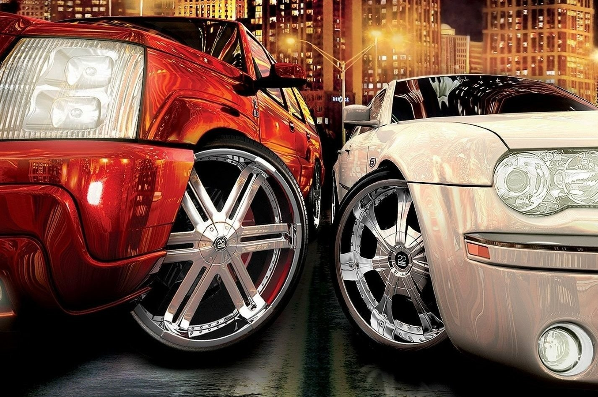
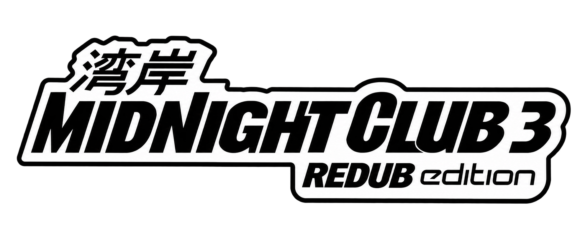

<strong>A Windows community edition built through static recompilation.</strong> 
Original Xbox code translated to native C, with OpenGL and Vulkan renderers, DLSS Super Resolution, and a portable launcher.

<a href="https://github.com/dea7hsmiless/Midnight-Club-3-ReDUB/tree/main">Source</a> · <a href="https://github.com/dea7hsmiless/Midnight-Club-3-ReDUB/releases">Releases</a> · <a href="BUILDING-WINDOWS.md">Build from source</a>

# Midnight Club 3: ReDUB

A Windows-focused community edition of **Midnight Club 3: DUB Edition Remix**, built on [mcdub3-nx](https://github.com/laureladastra/mcdub3-nx) and [xboxrecomp](https://github.com/sp00nznet/xboxrecomp).

ReDUB combines a portable setup launcher, native in-game Port Options, graphics adjustments, Xbox controller support, and optional PC music integration.

**Bring your own original Xbox Remix game files. No disc image, game assets, soundtrack, or saves are included.** This project is unofficial and is not affiliated with Rockstar Games, Take-Two, or Microsoft.

## Which game files do I need?

Use **Midnight Club 3: DUB Edition Remix for the original Xbox** (the first Xbox console). Supply your own supported Xbox ISO/XISO disc dump, or the complete extracted Xbox disc folder containing `default.xbe` and all remaining game data.

**PS2/PCSX2 images, the non-Remix DUB Edition, and Nintendo Switch NSP/XCI/NRO files are not compatible inputs.** Xbox 360/One/Series controller support does not change the required source game. Upstream Switch builds are an output platform, not a source disc format.

Use only game files you are legally authorized to use. Where permitted, these may come from your own disc backup; applicable law and license terms vary. ReDUB does not provide game downloads or permission to redistribute copyrighted game data. Its source-code license does not license the game's executable, assets, or soundtrack.

## Quick start

1. Put the self-contained **ReDUB Launcher.exe** in the writable folder where you want to install and build, such as `D:\Games\ReDUB`. It includes artwork and setup source and restores missing setup files beside itself. A full source checkout also works.
2. Open **ReDUB Launcher.exe**. From source without that executable, open **Launch ReDUB.cmd** to compile the launcher using Windows' .NET Framework compiler.
3. For a new installation, select your **original Xbox DUB Edition Remix ISO** or complete extracted Xbox folder.
4. Choose **Build / Repair**. The first build installs missing tools, extracts or copies game data, converts game code, and compiles the Windows executable. Internet access is required for missing dependencies. Later builds reuse conversion and compiler caches.
5. Choose **Play**. Open **Options → Port Options** for graphics and PC Music settings.

An existing installation is detected automatically and can play without rebuilding. The launcher does not download games or pull source updates from GitHub.

## Launcher

The sidebar layout is inspired by [SafeHouse](https://github.com/FridiNaTor1/SafeHouse/tree/main/launcher/ui), with ReDUB's own code and branding.

| Page | Purpose |
| --- | --- |
| Game | Installation status, Play/Install, verification, repair, game folder, desktop/library shortcuts. |
| Install | Choose Xbox Remix data, build/repair, or perform a full game-code rebuild. |
| Settings | Display, Graphics, Controls, Music, Diagnostics, and Launcher groups. |
| Support | Local build output, setup checks, logs, and this guide. |
| About | Project identity, features, limitations, and upstream credits. |

Enable **Settings → Launcher → Skip launcher on startup** to start the installed game directly. This is off by default. Hold **Shift** while starting, or use **Open ReDUB Launcher.cmd**, to open the launcher again. Missing required files fall back to setup. The preference is stored separately in `launcher/preferences.ini`.

**Settings → Graphics → Render queue** exposes the existing renderer queue limit. One frame can reduce queued input delay; two frames is the default and may tolerate uneven rendering better. Restart to apply it. This does not unlock the original frame-rate target.

Close the game before changing launcher game settings. During gameplay, use native Port Options for supported live changes. Launcher saves preserve comments and unrelated settings, write atomically, and retain an initial `.launcher-backup`. Graphics presets preserve HUD quality, gamma, brightness, and music preferences.

Setup output appears on Support. Save and close the game before installing a build. Existing game files, saves, and settings are preserved; there is no destructive reset/delete button. Move the complete installation together to retain installed game data and recreate shortcuts afterward. Moving only the launcher carries artwork and setup source, not game data. It builds in its new folder rather than using an old installation. Paths with spaces use a build-tool junction alias; files stay in the selected folder. Paths are relative and compiler caches are separated by location.

Optional artwork lives in `launcher/art`: `hero.jpg` or `hero.png`, `logo.png`, and `redub.ico`. Restart to reload images. Missing or unreadable images use the gradient/text fallback. See the [artwork guide and provenance](launcher/art/ARTWORK.md).

## Graphics and display

These settings are available through native **Port Options** with controller navigation. Render queue is currently launcher-only.

### Experimental Vulkan and DLSS

The original OpenGL renderer remains available. **Settings → Graphics → Graphics API** selects OpenGL or Vulkan; both renderers share Career/profile data and local Xbox system data. Its **DLSS Super Resolution** control is a familiar On/Off switch, with **Quality**, **Balanced**, and **Performance** modes. Choosing **Play** builds missing Vulkan/DLSS files automatically. All three modes passed controlled GPU evaluations on an RTX 3070. Quality, Balanced, and Performance also passed short user driving checks on that system with jitter disabled. Other GPUs/drivers and longer sessions remain unverified. If DLSS cannot initialize, Vulkan falls back to native rendering. NVIDIA runtime files are downloaded into ignored build data and are not part of the GitHub source package. Fullscreen and resolution settings are shared with Vulkan and persist across launches.

Vulkan now follows OpenGL for small effects-buffer scaling, render-texture padding sampling, and fixed-function texture matrices. User checks found the earlier white border and blurred right-side strip resolved, with particles and race markers animating correctly. No presentation crop is applied. DLSS jitter is disabled by default because it caused fine-detail shaking in local testing. No frame generation or higher simulation rate is included.

| Setting | Behavior |
| --- | --- |
| Fullscreen | Live borderless desktop fullscreen; **F11** and **Alt+Enter** also toggle it. |
| VSync | Off, On, Adaptive; unsupported adaptive mode falls back through SDL. |
| Presets | Performance, Balanced, Quality, and Custom after adjustments. |
| Render scale | 1×, 1.5×, 2×, 3×, 5×; restart required. |
| HUD texture quality | Independent 1×, 2×, 3×, 5× upscaling; restart required. Improves existing art rather than supplying an HD asset pack. |
| FXAA | Off, Low, Standard, High; changes live while driving. Menus/loading bypass it for sharp text, and DLSS bypasses it to avoid double anti-aliasing. |
| Texture filtering | 1×, 4×, 16× anisotropic filtering; restart required. |
| Sharpening | 0–100% in 25% steps, live; uses the FXAA presentation path. |
| Gamma | 0.8–1.4, live even with FXAA off; default 1.0. |
| Brightness | 80–120%, live even with FXAA off; default 100%. |
| FPS overlay | Frame rate and smoothed frame-time display. |
| Restore Graphics Defaults | Balanced graphics, HUD 2×, neutral image adjustments, FPS overlay off; music and fullscreen retained. |

| Preset | World scale | Filtering | Sharpening | VSync |
| --- | --- | --- | --- | --- |
| Performance | 1.5× | 4× | 25% | Off |
| Balanced | 2× | 16× | 50% | Off |
| Quality | 3× | 16× | 50% | On |

Presets enable standard FXAA and preserve HUD quality, gamma, and brightness. Restart for scale and filtering changes; FXAA changes live. VSync Off may reduce display latency with possible tearing; no setting guarantees zero input lag.

## HD texture packs

The renderer's native replacement loader uses Xbox texture hashes and PNG files at `hd/textures/<16-digit-hash>.png`. No replacement pack is included. Replacement decoding runs on a background worker; large packs can still increase memory and loading costs. Shader caching already exists in the renderer.

**PCSX2 texture packs do not work directly.** PS2 identifiers differ from Xbox hashes; DDS images also need conversion to PNG. Reusing artwork requires matching replacements to Xbox textures, not renaming a folder. A small mapping trial should precede a full conversion. Do not redistribute a pack without its author's permission.

The supplied desktop folder is named `ULUS10021`: it is a **PSP** pack for *Midnight Club 3: DUB Edition*, not a PS2/PCSX2 pack or DUB Edition Remix. Its `textures.ini` uses PPSSPP quick hashes (24 hex digits); ReDUB's loader hashes the original Xbox texture bytes, format, dimensions, and palette into 16-digit filenames. It cannot identify this pack's replacements from those hashes. The original DUB Edition and Remix also differ in game content, so this is not a drop-in replacement set. No files from that pack are included in this repository. See [texture-pack compatibility](docs/TEXTURE-PACK-COMPATIBILITY.md).

## Controllers

Xbox controllers use SDL's controller mappings, including Xbox 360 and Xbox One-family devices recognized by the runtime. Windows setup preserves the tested native SDL2 runtime. Connect before launching if detection is inconsistent. Port Options uses normal controller navigation.

With PC Music enabled while driving, **D-pad Left/Right** request previous/next tracks. Holding a direction sends one request. The player must expose Windows media-session skip controls. Menu navigation and normal radio behavior with PC Music off are retained.

**Settings → Controls** adjusts controller and wheel rumble strength. Raw SDL steering-wheel input is an experimental compatibility path with device/axis selection, inversion, and deadzone controls. It maps wheel steering, pedals, hats, and buttons into the game's Xbox controller input. It has not been tested across a range of physical wheels. Rumble works only when the connected device/runtime exposes it; full wheel force-feedback effects, wheel-specific shifter/clutch mappings, and per-game sensitivity curves are not implemented.

## PC Music / Now Playing

Start Spotify, YouTube, or another Windows player normally, then enable **PC Music (Driving)**. No Spotify login or account connection is needed.

- Audio continues through Windows; ReDUB does **not** capture and replay system audio.
- Driving silences the game's radio/music category while retaining engine, dialogue, and effects.
- Menus restore game music. The helper pauses the selected external session once per menu visit and resumes that exact session when driving resumes. It does not start a player that was already manually paused and avoids resuming over another playing app.
- Failed resume requests retain ownership and retry. Start the desired player once before testing, especially after changing apps.
- Title and artist appear for about **six seconds**. A new track triggers a fresh announcement; repeated metadata polls do not.
- **Song Display: Radio + Fallback** prefers the native cruising radio-title area. Unsupported fonts, long titles, or unavailable HUDs use the Unicode backup. Shared routing stops native animation before fallback and suppresses muted game-radio notifications while PC Music owns the display.
- **Song Display: Overlay** selects the backup directly.
- **PC Music Volume** adjusts the matched player's Windows mixer session in 10% steps. This affects that app outside the game too; browser tabs may share a session. Windows master volume is unchanged.

Features depend on the player's Windows metadata and transport support. Not every app/tab supports title reporting, volume matching, skip, pause, or resume. Metadata normally updates once a second; playback commands run through a background helper. Unsupported operations appear in the log.

## Stability work and limitations

Included fixes developed through local testing:

- Native menu ownership/lifetime validation, row bounds, and build re-entry protection.
- Port Options Back handling preserves the native input-enable flag; confirmation presses are debounced.
- Asynchronous Windows settings dispatch avoids waiting on the window thread from guest callbacks.
- Atomic settings saves no longer add a blank line on every adjustment.
- OHCI DMA/guest interrupt synchronization for a captured USB descriptor race.
- Startup vblank acknowledgement and verified GPU-fence notification recovery.
- Bounded pushbuffer execution publishes actual GET, retains incomplete packets, and refreshes stale endpoints after ring reuse. Captured race-command replay checks cover the failure that prompted this work.
- Career-menu music restoration after a zero-volume configuration reset.
- Idle native message-prompt handling removes a clipped blue/white screen edge.

**Windows remains experimental.** These fixes do not establish that every crash or hitch is eliminated. A later long-running local session produced invalid GPU pushbuffer jump warnings; that case remains under investigation. Multiplayer and every career event have not been exhaustively validated.

The original **30 FPS simulation target** remains. 60/120 FPS modes, frame generation, and ray tracing are not included.

## Requirements and troubleshooting

- x64 Windows and a GPU/driver supporting the existing OpenGL renderer (OpenGL 3.3 or newer).
- Complete supported original Xbox Remix data. Modified/unsupported executables may not match converted code.
- A writable folder, free space for extracted data and build caches, and internet for missing dependencies.
- Source builds use MSYS2/Clang tools. The launcher uses Windows' .NET Framework compiler, with no separate Node/Python launcher runtime download.

Start with **Verify setup** or **Support → Check setup**. For performance, try Performance and restart; high HUD scale also increases GPU work. For controllers, check Windows recognition and retain the supplied SDL2 runtime. For music, start the desired player once and check its Windows media controls.

Logs: `work-remix/logs`. Build backups: `work-remix/build-backups`. Inspect logs for personal paths/media titles before choosing to share them. Do not delete saves as a troubleshooting step.

## Building and project layout

See [Windows build instructions](BUILDING-WINDOWS.md). ReDUB builds on the [mcdub3-nx project](https://github.com/laureladastra/mcdub3-nx) and the [xboxrecomp toolkit](https://github.com/sp00nznet/xboxrecomp).

- `.portable/Launcher.cs`: launcher source.
- `.portable/Build-Launcher.ps1`: compile launcher/create shortcuts.
- `.portable/Build.ps1`: setup, repair, build, and prerequisite checks.
- `src/windows_settings.c`: native options dispatch/persistence.
- `src/windows_media.c` and `tools/windows/now_playing.ps1`: optional Windows media integration.
- `work-remix/build-windows-x86_64/dist`: installed game/settings.

Use `-NoInstall` to stage a game build while playing. Save and close before installation. The launcher does not automatically update source or publish to GitHub.

## Credits and licensing

ReDUB builds on [laureladastra/mcdub3-nx](https://github.com/laureladastra/mcdub3-nx), [sp00nznet/xboxrecomp](https://github.com/sp00nznet/xboxrecomp), and their contributors. SafeHouse inspired the launcher layout; ReDUB has its own implementation. SDL, FFmpeg, and other dependencies retain their licenses/notices. See repository license files and upstream documentation.

Game names, trademarks, executable code, soundtrack, and original artwork belong to their rights holders. Artwork provenance is documented separately; inclusion does not grant redistribution rights for third-party material. The source-code license does not license game data or texture packs.

Anti-aliasing offers FXAA Low, standard FXAA, and FXAA High during driving; menus and loading screens bypass it to preserve sharp text, and DLSS does not stack it. MSAA is not included because it requires multisampled render targets, depth handling, and resolve support; SMAA is not included.
